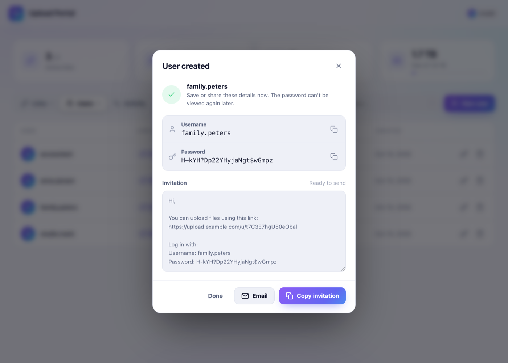

<p align="center">
  
</p>

<h1 align="center">Upload Portal for Synology NAS</h1>

<p align="center">
  <b>Secure, password-protected upload links for Synology DSM 7.</b><br>
  Let clients, family and colleagues upload files straight into a folder on your NAS: drag & drop, huge files, live progress and speed.
</p>

<p align="center">
  <a href="https://github.com/ronaldjonkers/SynologyUpload/releases/latest"></a>
  <a href="https://github.com/ronaldjonkers/SynologyUpload/releases"></a>
  
  <a href="LICENSE"></a>
</p>

<p align="center">
  <a href="#installation">Installation</a> ·
  <a href="docs/USER-GUIDE.md">User guide</a> ·
  <a href="docs/HANDLEIDING.md">Nederlandse handleiding</a> ·
  <a href="#faq">FAQ</a> ·
  <a href="README.nl.md">🇳🇱 Nederlands</a>
</p>

---

**Upload Portal** is a free, open-source **Synology package (.spk)** that turns your NAS into a private file-receiving service, a self-hosted alternative to Dropbox File Requests, WeTransfer or Google Drive upload forms. You create **upload links**, choose **which folder on your NAS** each link saves to, and decide **who** can use it with a username and password. People open the link in any browser, log in and drag their files in. No DSM account, no File Station access, no third-party cloud.


## Features

- 📦 **Native Synology package**: install via *Package Center → Manual Install*. It runs on DSM 7 with Node.js; no Docker needed.
- 🔗 **Upload links per folder**: every link saves directly into the shared folder or subfolder you pick, on any volume.
- 👤 **Separate upload accounts**: upload-only users with a username and password, independent of your DSM users.
- 🔐 **Strong password generator**: 24 characters by default (12–64), with a strength meter and one-click copy.
- ✉️ **Ready-to-send invitations**: copy or email a message containing the link and login details.
- 🖱️ **Drag & drop** of files and whole folders, plus file pickers that work on desktop and mobile.
- 📊 **Live progress, upload speed (MB/s) and time remaining**, per file and in total.
- 🚀 **Large files (many GBs)**: chunked, resumable uploads with automatic retry when the connection drops.
- 🧾 Per link: **allowed file types** (e.g. `jpg, png, pdf`), **maximum file size** and **expiry date**.
- 🛡️ **Safe by default**: files are never overwritten (`photo (1).jpg`), passwords are hashed with scrypt, logins are rate-limited, and uploads can't escape the chosen folder.
- 🧭 **Admin app inside DSM**: uses your DSM login (administrators only), with search, an activity log and a free-space overview.
- 🌗 Modern, responsive interface; the upload page follows light/dark mode.

<table>
  <tr>
    <td></td>
    <td></td>
  </tr>
  <tr>
    <td></td>
    <td></td>
  </tr>
</table>

## Requirements

- Synology NAS with **DSM 7.0 or newer** (any model; the package is architecture-independent)
- **Node.js v20** from Package Center (installed automatically as a dependency)
- Optional: a domain name and HTTPS via DSM's reverse proxy, to use links outside your own network

## Installation

1. **Download** the latest `UploadPortal-x.y.z.spk` from the [**Releases page**](https://github.com/ronaldjonkers/SynologyUpload/releases/latest).
2. In DSM, open **Package Center → Settings → General → Trust Level** and select **Any publisher**. This is required for packages that are not signed by Synology.
3. Go to **Package Center → Manual Install**, select the `.spk` file and follow the steps. Package Center installs Node.js v20 if needed.
4. Open **Upload Portal** from the DSM main menu.

Updating works the same way: install the newer `.spk` over the existing one. Users, links and history are kept.

👉 Full step-by-step instructions, including HTTPS and folder permissions, are in the **[User guide](docs/USER-GUIDE.md)** ([Nederlands](docs/HANDLEIDING.md)).

## Quick start

1. **Users → New user**: a strong password is generated for you.
2. **Links → New link**: name it, choose the destination folder on your NAS, tick the users who may upload, and optionally set allowed file types, a maximum size or an expiry date.
3. If a folder shows **No access**, click **Grant access**, or give the system user `UploadPortal` read/write permission in *Control Panel → Shared Folder*.
4. Click **Share** and send the invitation.

Upload pages are served on port **8090** (`http://<nas-ip>:8090/u/<code>`). To share links over the internet, put DSM's **reverse proxy** with a Let's Encrypt certificate in front of it and enter your public address under **Settings**. See [Access from the internet](docs/USER-GUIDE.md#6-access-from-the-internet-https).

## FAQ

<details>
<summary><b>How do I let clients upload files to my Synology NAS without giving them a DSM account?</b></summary>

Install Upload Portal, create an upload user and an upload link for the folder you want, and send the link. Upload users only exist inside Upload Portal. They can't log in to DSM, File Station or SMB, and they only ever see the upload page.
</details>

<details>
<summary><b>How is this different from Synology File Station's file request?</b></summary>

A File Station file request is one shared link, optionally protected with a single password. Upload Portal gives every person their own login, lets you restrict file types and file size per link, keeps an activity log of who uploaded what, uses resumable chunked uploads for very large files, and shows live speed and time remaining.
</details>

<details>
<summary><b>Can uploaders see or download files that are already in the folder?</b></summary>

No. Upload Portal only accepts uploads. It never lists or serves existing files to uploaders.
</details>

<details>
<summary><b>Is there a file size limit?</b></summary>

Only the limit you set per link and your free disk space. Files are sent in 8 MB chunks, so multi-gigabyte uploads also work behind reverse proxies, and they resume automatically after a network hiccup.
</details>

<details>
<summary><b>Does it need Docker or Container Manager?</b></summary>

No. It is a native DSM package that runs on Synology's own Node.js v20 package.
</details>

<details>
<summary><b>Which Synology models are supported?</b></summary>

Any model that runs DSM 7.0 or newer and offers Node.js v20 in Package Center.
</details>

<details>
<summary><b>"Grant access" doesn't work. What now?</b></summary>

Set it manually: *Control Panel → Shared Folder → (your folder) → Edit → Permissions*, choose **System internal user** in the drop-down, and give **UploadPortal** *Read/Write*. See [Folder permissions](docs/USER-GUIDE.md#4-folder-permissions).
</details>

## How it works

| Component | Location on the NAS |
|---|---|
| Upload server (Node.js, port 8090) | `/var/packages/UploadPortal/target/app` |
| Admin app in DSM | `/var/packages/UploadPortal/target/ui` → `/webman/3rdparty/UploadPortal/` |
| Database, key and log | `/var/packages/UploadPortal/var` (`db.json`, `server.log`) |
| Uploaded files | the folder you choose per link |

The admin app runs inside DSM and calls a small CGI bridge (`api.cgi`). The bridge verifies your DSM session and membership of the `administrators` group, then forwards the request to the local server with a secret key that only the package can read. The admin API is never exposed to the network.

## Building from source

```bash
git clone https://github.com/ronaldjonkers/SynologyUpload.git
cd SynologyUpload
npm install
npm run check     # syntax check
npm run build     # → dist/UploadPortal-<version>.spk + .sha256
```

Run the upload server locally for development (uses `./dev-shares` as fake shared folders):

```bash
npm start         # http://localhost:8090
```

Releases are built and published automatically by GitHub Actions when a `v*` tag is pushed.

## Contributing & support

- 🐞 Bugs and feature requests: [open an issue](https://github.com/ronaldjonkers/SynologyUpload/issues)
- 🔒 Security issues: see [SECURITY.md](SECURITY.md)
- 🤝 Pull requests welcome: see [CONTRIBUTING.md](CONTRIBUTING.md)
- 📝 Changes per version: [CHANGELOG.md](CHANGELOG.md)

## License

[MIT](LICENSE) © Ronald Jonkers. Not affiliated with or endorsed by Synology Inc. *Synology* and *DSM* are trademarks of Synology Inc.

<sub>Keywords: Synology upload link, Synology file request, receive files on Synology NAS, client upload portal, DSM 7 package, SPK, self-hosted WeTransfer alternative, Dropbox File Request alternative, password-protected upload page, drag and drop upload, large file upload to NAS.</sub>
