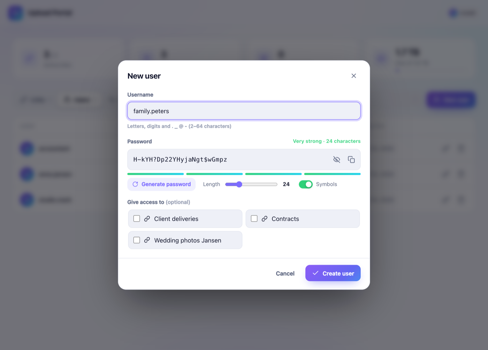
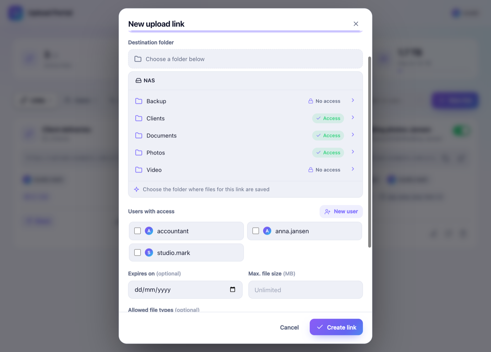
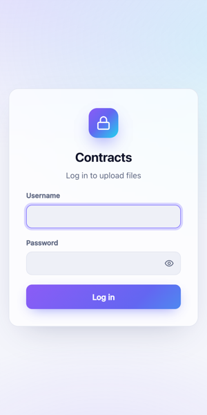

# User guide: Upload Portal for Synology NAS

This guide explains how to install **Upload Portal** on a Synology NAS running **DSM 7**, how to create **secure upload links** that save files into a folder you choose, and how to share those links safely over the internet.

🇳🇱 Liever Nederlands? Lees de [Nederlandse handleiding](HANDLEIDING.md).

**Contents**

1. [Requirements](#1-requirements)
2. [Installation](#2-installation)
3. [Creating upload users](#3-creating-upload-users)
4. [Folder permissions](#4-folder-permissions)
5. [Creating and sharing upload links](#5-creating-and-sharing-upload-links)
6. [Access from the internet (HTTPS)](#6-access-from-the-internet-https)
7. [What uploaders see](#7-what-uploaders-see)
8. [Activity and logs](#8-activity-and-logs)
9. [Updating, backup and uninstalling](#9-updating-backup-and-uninstalling)
10. [Troubleshooting](#10-troubleshooting)
11. [Security](#11-security)

---

## 1. Requirements

- A Synology NAS with **DSM 7.0 or newer**
- **Node.js v20** from Package Center (installed automatically if missing)
- An administrator account on DSM
- Optional, for sharing links outside your own network: a (sub)domain that points to your NAS, and port 443 forwarded to the NAS

## 2. Installation

1. Download the latest **`UploadPortal-x.y.z.spk`** from the [Releases page](https://github.com/ronaldjonkers/SynologyUpload/releases/latest).
   Optionally verify the download with the `.sha256` file next to it.
2. Open **Package Center → Settings → General**. Under **Trust Level** choose **Any publisher** and click **OK**.
   *Upload Portal is not signed by Synology; DSM only installs such packages with this setting.*
3. Click **Manual Install**, choose the `.spk` file and click **Next**.
4. If Node.js v20 is not installed yet, Package Center asks to install it. Confirm.
5. Accept the third-party warning and finish the installation.
6. Open the **main menu** in DSM and start **Upload Portal**. Only users in the `administrators` group can see and open it.

After installation the upload server runs on port **8090**. The admin app runs in a normal DSM window and uses your DSM login, so there is no separate admin password.

## 3. Creating upload users

Upload users are **not** DSM users. They can only log in on upload pages and have no access to DSM, File Station, SMB or anything else on your NAS.

1. Go to the **Users** tab and click **New user**.
2. Enter a **username**, for example `anna.jansen` or an email address.
3. A **secure password** is generated automatically:
   - 24 characters by default with upper- and lowercase letters, digits and symbols
   - use the **Length** slider for 12–64 characters, and toggle **Symbols**
   - ambiguous characters such as `0/O` and `1/l/I` are never used
   - the strength meter shows how strong the password is
4. Optionally tick the links this user may use straight away.
5. Click **Create user**.

You now see the login details **once**, each with a copy button, plus a **ready-to-send invitation** that you can copy or email. The password cannot be viewed later. If it gets lost, set a new one with the 🔑 key icon next to the user. Existing sessions of that user are logged out immediately.

## 4. Folder permissions

DSM 7 runs every third-party package as its own system user. Upload Portal can therefore only save files in shared folders where the system user **`UploadPortal`** has **read/write** permission.

In the folder picker of a link you can see per shared folder:

- ✅ **Access**: uploads are possible
- 🔒 **No access**: permission is still missing

**Option A: from the app.** Open the folder and click **Grant access**. Upload Portal sets the permission via DSM, using your admin session.

**Option B: manually in DSM**

1. Open **Control Panel → Shared Folder**.
2. Select the shared folder and click **Edit**.
3. Open the **Permissions** tab and choose **System internal user** in the drop-down at the top left.
4. Find **UploadPortal**, tick **Read/Write** and click **Save**.

The permission applies to the whole shared folder, including all subfolders.

## 5. Creating and sharing upload links

1. Go to the **Links** tab and click **New link**.
2. **Name**: what uploaders see, e.g. "Wedding photos Jansen".
3. **Destination folder**: click through your NAS and pick the folder. Files are saved **directly in this folder**; Upload Portal never creates subfolders. Even when someone drops a whole folder, all files land in the chosen folder.
4. **Users with access**: tick who may upload. You can also create a new user right here.
5. Optional settings:
   - **Expires on**: after this date the link stops working
   - **Max. file size** in MB
   - **Allowed file types**: comma-separated extensions such as `jpg, png, pdf`. Quick buttons add common groups: photos, video, documents, audio and archives. Leave empty to allow everything. Other types are refused with a clear message stating which types are allowed.
   - **Link is active**: turn a link off temporarily without deleting it
6. Click **Create link**. The **share** window opens with the URL and an invitation text that you can copy or email.

**Managing links.** Every link card shows the folder, users, limits and the number of uploads. You can:

- **Share**: copy the link or the invitation again
- ✏️ **Edit**: change any setting
- 🔄 **New URL**: the old address stops working immediately, which is useful if a link was shared with the wrong person
- 🗑️ **Delete**: uploaded files stay on your NAS

> **Tip:** send the password through a different channel than the link, for example the link by email and the password by text message.

## 6. Access from the internet (HTTPS)

Upload pages are served on `http://<nas-ip>:8090` inside your network. To share links with people outside, use DSM's built-in **reverse proxy** with HTTPS:

1. Point a (sub)domain such as `upload.example.com` to your public IP address. Synology DDNS also works.
2. On your router, forward **TCP port 443** to your NAS.
3. In DSM open **Control Panel → Login Portal → Advanced → Reverse Proxy → Create**:

   | | Source | Destination |
   |---|---|---|
   | Protocol | HTTPS | HTTP |
   | Hostname | `upload.example.com` | `localhost` |
   | Port | 443 | 8090 |

4. Get a free certificate: **Control Panel → Security → Certificate → Add → Let's Encrypt** for `upload.example.com`, and assign it to the reverse proxy entry under **Settings**.
5. In Upload Portal go to **Settings** and enter `https://upload.example.com` as the public address. All links now use this address.

Do **not** forward port 8090 itself to the internet; let the reverse proxy handle HTTPS.

## 7. What uploaders see

1. They open the link and log in with their username and password. Caps-lock warnings and a show-password button help with long passwords.
2. They drag files (or whole folders) onto the page, or use **Choose files** / **Choose folder**. The page lists the allowed file types and the maximum size when these are set.
3. Each file shows a progress bar, its speed and the remaining time. The summary shows the total progress, the speed in MB/s, the time remaining and the number of files done.
4. Files that aren't allowed are **skipped** with a message, while the other files keep uploading.
5. When the connection drops, uploads resume automatically. Closing the tab during an upload triggers a warning.
6. If a file with the same name already exists, the new one is saved as `name (1).ext`. Nothing is ever overwritten.

## 8. Activity and logs

- The **Activity** tab lists every upload with file, user, link, size and time, and you can search it.
- The overview at the top shows active links, users, the total uploaded and free disk space.
- Server log: `/var/packages/UploadPortal/var/server.log`. Package Center also links to it via **Upload Portal → View log**.

## 9. Updating, backup and uninstalling

- **Update:** download the new `.spk` and use **Manual Install** again. Data is kept. Afterwards, refresh DSM in your browser (Ctrl/Cmd + Shift + R).
- **Backup:** all users, links and history are stored in one file: `/var/packages/UploadPortal/var/db.json`. To back it up, copy it over SSH, for example `sudo cp /var/packages/UploadPortal/var/db.json /volume1/backup/`. That folder is included in your normal backups.
- **Uninstall:** via Package Center. Uploaded files stay in your shared folders. The package data (`db.json`) may be removed, so make a backup first if you want to keep your links.

## 10. Troubleshooting

| Problem | Solution |
|---|---|
| The package does not install | Set *Trust Level* to **Any publisher** and make sure Node.js v20 is available in Package Center. |
| "Upload Portal is not running" in the admin app | Start the package in Package Center and check `server.log`. |
| "Your DSM session has expired" | Refresh the DSM page and open the app again. |
| A folder shows **No access** | See [Folder permissions](#4-folder-permissions). |
| A link card shows "Folder not found" | The folder was renamed or deleted. Edit the link and choose a folder again. |
| Links only work inside your own network | Set up the [reverse proxy](#6-access-from-the-internet-https) and fill in the public address under *Settings*. |
| Uploaders see "File type not allowed" | Add the extension under *allowed file types* for that link, or leave the field empty. |
| Too many login attempts | After 8 failed attempts the IP address is blocked for 15 minutes. |

Still stuck? [Open an issue](https://github.com/ronaldjonkers/SynologyUpload/issues) and include your DSM version and the relevant lines from `server.log`.

## 11. Security

- Upload users have **no access** to DSM or your files; they can only upload.
- Passwords are stored as **scrypt** hashes. Sessions use signed HttpOnly cookies.
- After 8 failed logins an IP address is blocked for 15 minutes.
- Upload names and paths are sanitized, so files can never be written outside the chosen folder.
- Existing files are never overwritten, and uploaders can't list or download files.
- The admin API is only reachable through DSM: it requires a valid DSM session from an administrator, and the CGI bridge then forwards the request with a secret key over localhost.
- Use HTTPS (section 6) when you share links over the internet.

Found a vulnerability? Please follow [SECURITY.md](../SECURITY.md).
