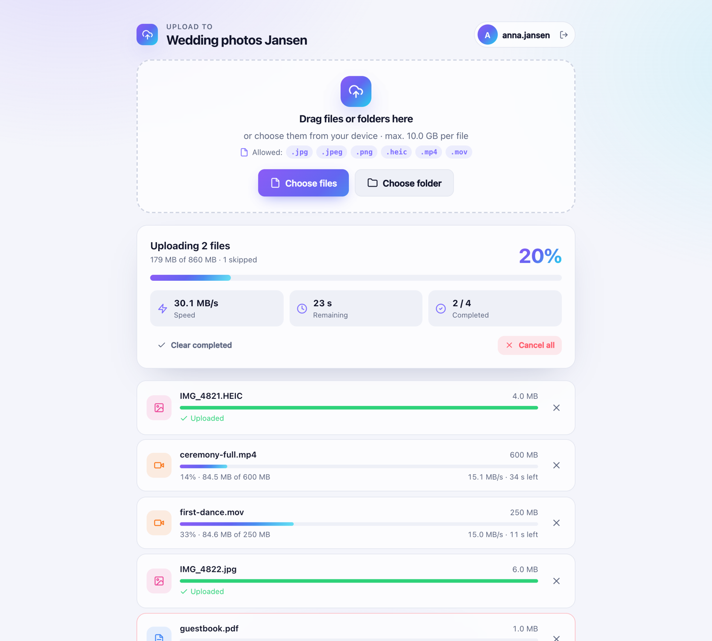
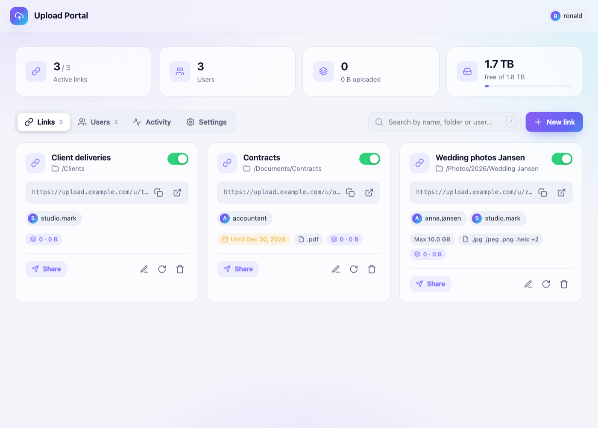

# Receive files on your Synology NAS with secure upload links

**Upload Portal** is a free, open-source package for **Synology DSM 7**. Create **password-protected upload links**, choose the **folder on your NAS** for each link, and let clients, family or colleagues upload files with **drag & drop**. You keep full control over your data, with no third-party cloud and no DSM accounts for uploaders.

[⬇️ Download the latest .spk](https://github.com/ronaldjonkers/SynologyUpload/releases/latest){: .btn} [📖 User guide](USER-GUIDE.html){: .btn} [🇳🇱 Handleiding](HANDLEIDING.html){: .btn}

## Why Upload Portal?

- **One link per folder**: files land exactly where you want them on your NAS.
- **Personal logins** for every uploader, with a built-in 24-character password generator.
- **Big files welcome**: chunked, resumable uploads with live MB/s and time remaining.
- **Control what comes in**: allowed file types, maximum size and expiry date per link.
- **Managed inside DSM**: an admin app in the DSM main menu that uses your DSM login.
- **Native package**: installs via Package Center; no Docker needed.

## Install in 3 steps

1. Download `UploadPortal-x.y.z.spk` from the [releases](https://github.com/ronaldjonkers/SynologyUpload/releases/latest).
2. In **Package Center → Settings**, set *Trust Level* to **Any publisher**.
3. **Package Center → Manual Install** → select the file → done.

Read the [full user guide](USER-GUIDE.html) for folder permissions, HTTPS via the DSM reverse proxy and troubleshooting.

## Frequently asked questions

**How can clients upload files to my Synology NAS without an account?**
Create an upload user and an upload link in Upload Portal. Upload users can only use the upload page; they have no access to DSM or File Station.

**Is it a replacement for WeTransfer or Dropbox File Requests?**
Yes. Files go straight to your own NAS, with per-person logins and no size limit other than your disk space.

**Which models are supported?**
Any Synology NAS running DSM 7.0 or newer that offers Node.js v20 in Package Center.

---

[GitHub repository](https://github.com/ronaldjonkers/SynologyUpload) · [Report an issue](https://github.com/ronaldjonkers/SynologyUpload/issues) · MIT License · Not affiliated with Synology Inc.
